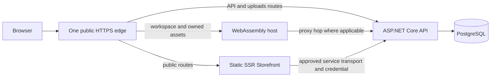

# Release Candidate readiness audit — 2026-11-01

## Decision and audited scope

**RC NO-GO** on `master` commit **`9abba4d642798aa1fabfe98fca72990022fb0d4a`**, the merge of PR #127. Production approval remains a separate owner decision and is not granted by this audit.

The application has substantial working functionality, including the public SSR catalog/search and the previously hardened commerce/session mechanisms. The reasons for NO-GO are concrete configuration/error-boundary defects and missing production-like evidence, rather than the absence of optional features. In particular:

1. Bank Transfer accepts incomplete merchant settings and returns a hardcoded fallback account (R02).
2. Strict registration depends on immediate SMTP success and can discard an account after the mail has already been accepted by a server (R03).
3. The first post-merge browser job failed; a single diagnostic rerun and isolated reproduction passed, but the startup intermittency remains unexplained (R01).
4. The selected public-host/proxy/service-observation arrangement, current-target recovery rehearsal and external provider lifecycle have not been validated as a release installation (R08–R10).
5. Artifact/source binding and required-check enforcement need owner action before publishing an RC (R11).

No P0 incident, real loss of funds, production compromise or authentication bypass was demonstrated. This is not proof that none exists. P1 findings require resolution or a specific, evidenced owner disposition before RC sign-off. P2 findings should have an explicit release disposition; they are not automatically critical blockers.

This report addresses [Issue #128](https://github.com/unrealbg/BlazorShop/issues/128). It is independent of earlier PR success claims: source, original CI reports, fresh local runs, real HTTP/Identity/PostgreSQL/SMTP observations and a real nginx fixture were checked. It is not a third-party penetration test, legal opinion, production inspection or exhaustive accessibility certification.

Only documentation, redacted evidence and standalone audit reproduction tools are changed by this PR. No application, authentication, refresh, payment, inventory, schema, hosting configuration or workflow is remediated. All database/order/mail activity described below used disposable synthetic fixtures. No production access, DNS change, live payment, real email delivery, release dispatch or merge was performed.

## Evidence ledger and provenance

| ID | Exact evidence | Result and limits |
| --- | --- | --- |
| E01 | Audited merge `9abba4d642798aa1fabfe98fca72990022fb0d4a`; PR head `c754fe2b64fd3c3b5ff35018163e0660d5313bb6` | Git trees are identical. This establishes source equality, not equality of timing/environment or a substitute for merge-commit checks. |
| E02 | [Merge CI attempt 1](https://github.com/unrealbg/BlazorShop/actions/runs/41290581869/attempts/1), [original browser artifact](https://github.com/unrealbg/BlazorShop/actions/runs/41290581869/artifacts/13077154867) | Build/tests/audits/containers passed. Chromium 40/40 twice; Firefox 10/11, one failure; WebKit not executed after the failure. Original TRX was downloaded and inspected. |
| E03 | [Merge CI attempt 2](https://github.com/unrealbg/BlazorShop/actions/runs/41290581869/attempts/2), [rerun browser artifact](https://github.com/unrealbg/BlazorShop/actions/runs/41290581869/artifacts/13077893942) | One diagnostic rerun of the failed job, on unchanged SHA: both Chromium series and Firefox/WebKit steps passed. Attempt 1 is retained as a finding, not erased or counted as success. |
| E04 | [Merge Code Analysis](https://github.com/unrealbg/BlazorShop/actions/runs/41290581818) | Passed with warnings as errors. GitGuardian passed on the PR head; no additional GitGuardian check run was present on the merge SHA when inspected. The matching source tree is relevant evidence, not an independent merge-scan claim. |
| E05 | [PostgreSQL 17/unit artifact](https://github.com/unrealbg/BlazorShop/actions/runs/41290581869/artifacts/13077072021), [PostgreSQL 16 artifact](https://github.com/unrealbg/BlazorShop/actions/runs/41290581869/artifacts/13077116707) | CI: 967 pass plus 10 unchanged opt-in smoke skips; focused PostgreSQL 16 job 67/67. Security verifiers retain 17 eligibility, 18 observation, 15 atomic refresh and 6 catalog cases per required job. |
| E06 | [npm JSON](https://github.com/unrealbg/BlazorShop/actions/runs/41290581869/artifacts/13076921984), [NuGet JSON](https://github.com/unrealbg/BlazorShop/actions/runs/41290581869/artifacts/13077256559), [published CSS evidence](https://github.com/unrealbg/BlazorShop/actions/runs/41290581869/artifacts/13077302072) | Full/runtime npm and transitive NuGet gates passed with zero findings. API/Storefront/Web builds, Compose rendering, published assets and unavailable-catalog response checks passed. These audits do not scan OS/container packages or prove an installation works behind TLS/proxies. |
| E07 | Fresh local Release restore/build and full suite on PostgreSQL 17 **and 16** | 0 warnings/errors; **967 passed + 10 existing opt-in skips on each version**. An initial `--no-restore` build needed the runtime pack for the locally updated SDK; normal restore resolved it. This tooling prerequisite is not an application defect. |
| E08 | [HTTP/mail/commerce observations](evidence/http-mail-commerce.json), [standalone reproduction](reproduction/README.md) | Real API controllers, application registrations, Identity, migrated disposable PostgreSQL and the actual MailKit email service against a loopback SMTP sink. No service mock is the final evidence for R02/R03/R06. |
| E09 | [nginx observations](evidence/web-header-observations.json), [nginx reproduction](reproduction/NginxHeaders.ps1) | Actual pinned nginx version and unchanged repository template; synthetic static files and loopback binding. This exercises header inheritance, not a deployed TLS edge. |
| E10 | [23 UI observations](evidence/ui-observations.json), [screenshots](#visual-and-accessibility-observations) | axe-core 4.14.0 plus browser timings, 320/390/768/1440 px, running application with synthetic data. Release binaries in Development Aspire hosting; not a published-container or field performance benchmark. |
| E11 | [Historical hosted rehearsal](https://github.com/unrealbg/BlazorShop/actions/runs/34407877015), [rehearsal specification](../../staging-upgrade-restore-rehearsal.md) | Historical workflow success is observable. Its application target is `8370f817857648f475041228ea6eaf228a3b9e34`, not this audit SHA. Original artifacts were no longer listed when inspected, so this audit does not independently attest their contents. |

CI artifacts have finite retention. Checked-in evidence contains no tokens, confirmation URLs, service credentials, account numbers, production addresses or private infrastructure values. Raw local diagnostics are not published. The reproduction tools record synthetic outcomes without storing credential values. A passing characterization probe means the observation completed; it does **not** turn an unsafe outcome into a feature PASS.

## Functional matrix

PASS means the stated path/assertion was exercised, with the indicated evidence and limits. FAIL identifies an observed failure. NOT TESTED means evidence is unavailable or inadequate for that claim. A row is not a certification of every possible state on that surface.

| Surface | Evidence / executed scope | Status | Severity / finding | Owner | Follow-up |
| --- | --- | --- | --- | --- | --- |
| SSR home/category/product navigation | E02/E03 real browser navigation, loaded images, slug/metadata assertions; E10 fresh page scans | PASS | No regression observed in these paths | Frontend | #128 |
| Public SSR catalog/search | `StorefrontCatalogTests`, real `PublicCatalogHttpTests` on PG16/17: six sorts, term/category/pagination, published-only results; native GET with JS disabled | PASS | Initial noindex policy is intentional | Frontend/API | #126 closed; #128 |
| Search encoding, empty/error/404/503, canonical/sitemap | HTTP rendering tests and published container unavailable-API check | PASS | Does not certify an actual edge cache | Frontend/operations | #128 / R08 |
| Raw public API pagination overflow | E08 valid integer query with excessive offset arithmetic returns HTTP 500 | **FAIL** | **P2 R14**; SSR UI guard remains effective | API | #128 |
| Legacy WebAssembly search | E02/E03 `CatalogSearch_PaginationLegacySearchAndCommerceHandoffs` | PASS | No caller migration claimed | Frontend | #128 |
| Product variants, prices and immutable snapshots | Browser simple/variant selection; PostgreSQL commerce tests; server-price and cross-product variant rejection source/tests | PASS | Public category visibility versus purchase eligibility differs, R06 | Commerce | #88/#89 closed; #128 |
| Cart persistence, malformed/null cookies, quantities/removal | Existing cart browser scenarios and hardening tests, including exact ProductId/VariantId/Quantity login handoff | PASS | Untrusted client state remains subject to server validation | Frontend/commerce | #128 |
| Healthy registration → confirmation → login | E08 actual SMTP sink and real Identity token confirmation over HTTP, then JWT/cookie issuance | PASS | Local sink only; external mail delivery not verified | Identity/email | #52 |
| Registration with SMTP outage/ambiguous delivery | E08 closed port and accepted DATA/lost acknowledgement | **FAIL** | **P1 R03** | Identity/email | #52 |
| Normal customer/admin authorization | Existing real HTTP security tests and browser role/ownership scenarios | PASS | Sampled endpoints; not an exhaustive endpoint fuzzing campaign | Security/API | #128 |
| Demo token/session binding, refresh, logout | Existing PG16/17 HTTP tests and browser isolation/coordination suites; source inspected | PASS | Production demo dataset/configuration acceptance is separate, R08/R12 | Security/owner | #128 |
| Refresh atomicity, replay, lock/deactivate eligibility | 17 + 18 + 15 mandatory HTTP cases per version, strict verifiers; browser coordination | PASS | Existing access JWT TTL and revocation limits remain, R12 | Security | #118/#123/#124/#125 contracts retained |
| Firefox cold secondary-tab readiness | E02 initial failure at `RefreshCoordinationTests.cs:300`; E03 retry; local unchanged test passes | **FAIL** | **P1 gate / R01**; product-security defect not established | Test/frontend | #128; #29 diagnostic overlap |
| COD / configured bank order / idempotent retry | Existing real commerce suite and E08 real HTTP order commits/replays | PASS | No physical delivery or bank transfer made | Commerce | #90–#94 closed |
| Bank checkout with missing merchant settings | E08 HTTP 200/success and fallback/missing account metadata | **FAIL** | **P1 R02** | Commerce/owner | #128 |
| Bank order when SMTP is unavailable | E08: both original and replay HTTP 200; one committed order | PASS | Email delivery can be lost; this does not prove durable recovery | Commerce/email | #52 / R03 |
| Inventory contention / insufficient stock / transaction rollback | Fresh full PostgreSQL suites on both 16 and 17; reservation/lifecycle/idempotency tests | PASS | No sustained-load or multi-node chaos benchmark | Commerce | #128 |
| Stripe signature/parser, duplicate/mismatched/late events, reservation/payment transitions | SDK parser tests plus PostgreSQL reconciliation tests and source inspection | PASS | Synthetic signed events/test doubles, not Stripe-hosted lifecycle proof | Payments | #93 closed; R10 |
| Actual Stripe sandbox checkout/webhook delivery across final HTTPS edge | No provider credentials or approved external installation used | **NOT TESTED** | **P1 gate R10**, not a demonstrated provider defect | Owner/payments | #128 |
| Customer orders/profile/password/notifications | Existing real browser customer account and loading/empty/error/retry cases; E10 account scans | PASS | External delivery and immediate JWT revocation not established | Frontend/API | #128 / R12 |
| Admin catalog/categories/variants/uploads/inventory/orders/users/settings/SEO/audit | Existing browser operational scenarios; server role guards and upload signature/size tests | PASS | No large-data CSV import/export claim; some settings intentionally read-only | Admin/API | #46 remaining CSV scope |
| Responsive bounds / keyboard / JS-disabled SSR | Existing 40-case suite plus E10 sampled running pages at four widths | PASS | Physical devices/screen readers not tested | Frontend | #31/#42 |
| Minimum text contrast / invalid-login list semantics | E10 actual axe violations | **FAIL** | **P2 R05** | Frontend | #31; #128 |
| Web hosting security-header coverage | E09 plain-file control versus HTML/SPA/CSS | **FAIL** | **P2 R04**; no authenticated framing exploit demonstrated | Web hosting | #26; #40 closed status is insufficient evidence |
| Full production CSP, TLS, CORS, cookie/navigation and proxy attribution | Source/routing reviewed; no final HTTPS installation exercised | **NOT TESTED** | **P1 gate R08** | Owner/operations/security | #26/#128 |
| Current-target full restore, uploads and data-protection continuity | E11 only proves a historical job result; current application recovery not executed | **NOT TESTED** | **P1 gate R09** | Operations/owner | #128 |
| Merchant identity, bank ownership, legal text and fulfillment suitability | No owner/legal/provider attestation supplied | **NOT TESTED** | Production gate R10, separate from code-test success | Merchant/legal/owner | #128 |
| Production performance, container OS CVEs/SBOM, monitoring and incident response | E10 is a local sample; CI npm/NuGet scope does not cover these | **NOT TESTED** | P2 risks / operational gates R10/R13 | Operations/frontend | #24/#25/#38/#42 |

## Prioritized findings and reproducible cases

### R01 — P1 readiness gate: post-merge Firefox bootstrap intermittency

**Classification:** confirmed CI failure; root cause and product defect unproven. Attempt 1 produced 40/40 Chromium twice and 10/11 Firefox. `TabClosesWithUncertainRefresh_AnotherTabRequiresLoginWithoutPost` failed while waiting five seconds for `#account-content h1` after opening the second account tab, at [line 300](https://github.com/unrealbg/BlazorShop/blob/9abba4d642798aa1fabfe98fca72990022fb0d4a/BlazorShop.E2E/RefreshCoordinationTests.cs#L300). Its accessibility snapshot contained only `Ready`. The adversarial refresh/closed-tab portion had not started. WebKit did not execute in that attempt.

**Reproduction:** inspect E02's original Firefox TRX; run the unchanged named test with Firefox as documented in the reproduction README. It passed locally once. A single diagnostic rerun of the complete failed browser job on the same merge SHA passed both Chromium runs and Firefox/WebKit. This establishes intermittency, not its cause or a repair.

**Recommendation:** preserve the failure and add startup/secondary-tab timing and request diagnostics in a small test-focused follow-up. Separate cold WASM boot readiness from refresh-protocol assertions; reproduce under controlled CPU/network conditions. Do not skip the case, silently increase timeouts until green, weaken strict replay or change refresh logic based only on this snapshot. An owner must disposition the unexplained instability before relying on the RC gate.

### R02 — P1 confirmed defect: incomplete bank settings fail open

**Evidence:** E08 `empty-bank-config`: a real authenticated bank checkout returned HTTP 200 and `success=true`, supplied a fallback IBAN, and omitted beneficiary and bank name. No transfer was made. [CheckoutOrchestrator.BuildBankTransferInfo](https://github.com/unrealbg/BlazorShop/blob/9abba4d642798aa1fabfe98fca72990022fb0d4a/BlazorShop.Application/Services/Payment/CheckoutOrchestrator.cs#L1140) substitutes an account when the option is blank. `PaymentMethodService` does not require valid bank merchant settings to expose Bank Transfer; Infrastructure configures the settings without a fail-closed bank validator.

**Reproduction:** run `SmtpProbe` against its disposable database/Identity host, leave bank settings absent, create a normal purchasable product, and POST `/api/cart/checkout` with a valid customer JWT, cart and fresh idempotency key selecting Bank Transfer. Inspect only the returned success and presence/absence of bank fields. No account number needs to be recorded or used.

**Impact:** configuration omission can present invented financial instructions as merchant-authoritative. A green happy-path test with prefilled synthetic bank details does not address this failure boundary.

**Minimal scope:** owner chooses either startup rejection when bank payments are enabled but incomplete, or exclusion of the method plus an independent checkout guard. Remove the fallback; validate merchant-approved details before order/reservation success. Preserve DTO shapes, idempotency, inventory and Stripe behavior. Add real HTTP negative tests asserting no successful order/reservation or substitute financial data. This requires a separately approved commerce/configuration fix, not a change in this audit.

### R03 — P1 confirmed defect against #52: SMTP controls registration durability

**Evidence:** with actual Identity and MailKit, closed SMTP caused registration HTTP 400 and deletion of the newly created user. In a second case the loopback server accepted the DATA into its captured queue and closed before acknowledgement: the API returned 400, deleted the account, and the captured confirmation link returned 400. The healthy control completed SMTP delivery, Identity confirmation and login. See E08 and [CreateUser](https://github.com/unrealbg/BlazorShop/blob/9abba4d642798aa1fabfe98fca72990022fb0d4a/BlazorShop.Application/Services/Authentication/AuthenticationService.cs#L112).

**Reproduction:** run `SmtpProbe` modes `healthy`, `closed-port`, and `accepted-data-lost-ack`; compare HTTP status, retained-user boolean, accepted-message count and confirmation status. Only loopback synthetic mail is involved.

**Impact:** an external mail failure blocks valid account creation; ambiguous delivery can send a link whose user has already been removed. This is a demonstrated availability/consistency problem, not a hypothetical claim that every business request rolls back. The bank-order control proves the opposite for commerce: mail failure still yields one committed order, and the same key replays it successfully. Bank mail lacks durable retry/recovery evidence. Newsletter uses a best-effort background task already, but that is not a durable outbox.

**Minimal scope:** approve the registration/account-confirmation delivery contract first, then a bounded durable enqueue/delivery design with message identity, retry/terminal status and recovery. Any outbox schema change needs explicit scope approval. Preserve Identity eligibility, token generation, transaction/idempotency contracts and logout. Template/provider abstractions are separable enhancements, not prerequisites for the smallest reliability fix. Do not claim exactly-once external SMTP delivery; test lost acknowledgement, retry and stale-link recovery explicitly.

### R04 — P2 confirmed hosting defect: cache locations drop inherited headers

**Evidence:** real nginx 1.27.5 with the repository template returned the configured frame/content-type headers for `/plain.txt`, while `/`, `/index.html`, `/account/profile` and `/audit.css` returned 200 without them. Their locations define their own cache header. [nginx.conf](https://github.com/unrealbg/BlazorShop/blob/9abba4d642798aa1fabfe98fca72990022fb0d4a/BlazorShop.Presentation/BlazorShop.Web/nginx.conf) therefore does not deliver its server-level security headers consistently. The standard nginx inheritance rule explains the observed difference.

**Reproduction:** run `NginxHeaders.ps1`; compare the control row and four cache/fallback rows. The fixture uses the exact template and synthetic files, not a production proxy. No authenticated clickjacking, XSS exploit or deployed-edge policy was demonstrated.

**Minimal scope:** restore the common headers in every relevant cache/error location using a version-compatible shared include or equivalent arrangement, then assert real HTTP headers on HTML, SPA fallback, CSS/JS and error responses. Do not paste the newer `add_header_inherit merge` directive into the pinned older nginx version. Complete #26's CSP work separately with enforced-policy browser validation; a meta policy and SRI do not establish full hosting-header coverage.

### R05 — P2 confirmed accessibility defects, not certification

**Contrast:** axe observed the missing-image text at **4.31:1**, below 4.5:1 for its 12.8 px normal text, on the sampled home/catalog/product surfaces. The shared placeholder foreground/background are the cause. The 12 failing snapshots reflect one shared defect across routes/widths, not twelve independent bugs.

**Validation semantics:** submitting the empty login form produced two `listitem` violations. The validation list's parent role is not `list`; [Login.razor](https://github.com/unrealbg/BlazorShop/blob/9abba4d642798aa1fabfe98fca72990022fb0d4a/BlazorShop.Presentation/BlazorShop.Web/Authentication/Components/Login.razor#L16) passes `role="alert"` onto `ValidationSummary`. Similar source patterns elsewhere require checks, not an untested blanket failure claim.

**Reproduction:** run `BrowserProbe`, inspect JSON violations and `login-invalid-390.png`; open a missing-image card and measure its rendered colors. All 23 sampled bounds checks reported no horizontal overflow. The login-invalid snapshot failed semantics despite the ordinary functional login tests being green.

**Minimal scope:** adjust the shared placeholder text contrast; preserve list semantics while placing any announcement role on an appropriate wrapper. Retain EditForm/DataAnnotations, labels, described-by relationships, focus and handlers. Add representative axe and keyboard checks; obtain screen-reader coverage separately. Do not suppress rules or redefine WCAG thresholds.

### R06 — P2 observed contract ambiguity: category visibility versus purchase eligibility

E08 published a product beneath an unpublished category. Public product lookup returned 404, while a normal authenticated COD checkout for that product succeeded with HTTP 200. `ResolveCartLinesAsync` checks product publication; the public read contract also excludes unpublished parents.

**Reproduction:** the `hidden-category-checkout` characterization in `SmtpProbe` creates only synthetic records, performs public lookup, then a normal checkout with the known fixture ID. It does not assert what the merchant's intended category policy must be.

**Owner decision:** determine whether category unpublication only removes discovery or must also prevent new purchases from stale carts. If the latter, approve a narrowly scoped consistent eligibility change and test products/categories becoming unpublished during checkout. Do not silently expand business rules under a visual/audit change. Until decided, document the discrepancy and do not represent category hiding as a purchase-control guarantee.

### R07 — P2 source risks: incomplete client resilience and error observability

#29 remains partially implemented: general WASM clients do not have an explicit centralized safe-read resilience policy. However, the refresh path **does** have its existing explicit 20-second deadline and strict browser coordination; claiming that all credential calls are unbounded would be incorrect. Boot awaits session restoration before `RunAsync`, so startup/readiness needs an independent budget and diagnostics. This observation may be relevant to R01 but does not prove its root cause.

Existing component retry/loading states and the global Blazor error element provide some recovery. #28's proposed ErrorBoundary/server-side client-error collection is not fully established. Production API exception middleware returns generic messages and trace identifiers; tests/source support that narrower claim. No deliberate unhandled component crash or complete production telemetry pipeline was exercised here.

**Recommendation:** fault-inject safe reads, aborted requests and slow bootstrap before selecting policies. Preserve credential handlers and the 20-second refresh boundary; never blindly retry refresh, login, checkout or payment creation. Use existing idempotency where replay is intended. Treat #28/#29 as targeted reliability work, not an invitation to replace working authentication architecture.

### R08 — P1 release-installation gate: routing, trust and service transport

The selected architectural direction is one public HTTPS host. The repository still needs an approved, exercised routing/trust arrangement. Local E2E uses same-host loopback origins on different ports: this is useful cross-origin testing, but it is **not** proof for distinct production hostnames or cross-site cookies.

Host-only refresh cookies are not shared among separate subdomains. The SSR layout can observe only credentials received on its request. SameSite and CORS do not make a host-only cookie visible on another host. The server-only observation client also correctly refuses prohibited transport; production provisioning remains separate. Do not weaken cookie scope, service-key gating or HTTPS requirements to make an unverified topology appear functional.

Rate limiting partitions on `RemoteIpAddress`. The reference Web proxy adds a hop, and the direct Storefront-to-API hop is another service source. Forwarded headers are consumed right-to-left with a configured trust boundary/limit. Without validating the complete chain, distinct visitors can share an edge/service IP bucket. SSR catalog calls can share their service bucket even though ordinary SSR page requests no longer rotate refresh tokens. This is a source-supported topology risk, not a claim that arbitrary client-supplied forwarding headers should be trusted.

**Proof obligations:** edge → Web → API attribution; direct Storefront → API transport/identity; rejection of forged headers from untrusted peers; browser and service budgets under load; HTTPS/cookie/protected-return behavior; canonical URL/robots/cache policy. Preserve all #118/#123/#124/#125 protections. C03 and unified routing are not implemented by this audit.

Suggested route ownership must explicitly cover public SSR pages, `/api`, `/uploads`, WebAssembly authentication/account/admin/legacy search/payment returns, `/_framework`, shared and SSR-specific CSS/JS, SPA fallback, legacy redirects and real 404s. Resolve the WebAssembly workspace root and static-asset ownership with compatibility evidence; do not silently redirect existing callers or let an SPA fallback swallow SSR/API errors.

This diagram is a target for verification, not a deployed configuration or approval to change infrastructure.

### R09 — P1 unverified recovery gate: historical rehearsal is not current-target recovery

The historical hosted workflow exists and succeeded. Its pinned application target is older than this audit. No EF migration files changed between that target and the audited SHA, which preserves the relevance of archive/migration tests, but does not rehearse the new runtime/session/UI installation. Original historical workflow artifacts were unavailable to this audit. It would be inaccurate both to claim no rehearsal ever existed and to claim current recovery was proven.

The archive's prohibition on rolling old/new writers still applies. SQL rename/Down tests and current PostgreSQL suites are not a complete restore of DB, uploads, data-protection keys, external provider state or post-backup activity.

**Required next evidence:** the disposable current-target rehearsal and recovery controls below, with an immutable artifact manifest and explicit owner sign-off. No such external deployment was executed during this audit.

### R10 — P1/P2 unverified operational/content gates

Before an RC installation is accepted, record actual sandbox/provider and operational evidence: Stripe test-mode delivery and retry/reconciliation, SMTP sink/provider recovery, upload persistence, data-protection continuity, readiness monitoring, rollback and recovery timing. Existing signed synthetic events and a local SMTP sink are valuable but do not prove the final external service/HTTPS integration. No live transaction or external email was performed.

Production additionally requires verified merchant identity/contact and bank ownership, approved Privacy/Terms, currency/fulfillment/tax/delivery suitability and provider configuration. The checkout contract does not establish a complete shipping-address workflow; no unsupported address or delivery capability should be inferred from a prototype. Existing public price presentation assumes EUR; accepting another backend currency is not evidence of complete multi-currency UI support. These need owner decisions, not unrequested feature development.

No container OS CVE/SBOM assessment, sustained-load benchmark, real-device/screen-reader audit, disaster-recovery exercise or operational alert test was completed. Mark these NOT TESTED and decide explicit release criteria. npm/NuGet zero findings are not a substitute.

### R11 — P1 release-provenance/governance risk

Read-only repository API inspection showed no active required-check protection/ruleset on the current default branch. Existing owner review and guarded manual merges are valuable process controls, but a workflow's presence does not enforce its success before a write/tag. No settings were modified.

The manual `release.yml` input is used to name/upload assets to a release, while its checkout step does not bind `ref` to that requested tag or compare the built commit with an approved audit manifest. Its test step is not the complete CI/security/browser gate. Consequently manual artifact publication is not source-bound by the workflow itself. This is a source-confirmed risk; no release dispatch was executed to demonstrate mispublication.

**Reproduction/verification:** inspect `release.yml` checkout versus `RELEASE_TAG` data flow and the repository's read-only protection/ruleset endpoints. A future isolated workflow test should prove that mismatched tag/SHA inputs fail before upload. Do not test this by publishing a real release.

**Owner action:** approve enforceable status/review rules and immutable tag/SHA/artifact provenance. Verify the exact source and required checks before packaging/upload, with appropriate approval boundaries. This audit does not change repository governance or run the release workflow.

### R12 — P2 accepted/conditional security-policy limits

- Already issued ordinary access JWTs retain the existing two-hour validity window. Lock/deactivate revoke refresh eligibility/sessions; they do not provide immediate access revocation. Role/password/logout global revocation policy was not added. Preserve the explicit [C01 boundary](../../security/account-lockout-refresh.md).
- The administrative password-change flag is stored, but ordinary login remains possible with that flag set in E08. Do not portray the flag as a demonstrated enforced sign-in policy. Clarification or enforcement requires separate owner approval, including the existing revocation-policy decision.
- Demo scope/token isolation is tested. Production demo dataset provenance/exposure and operational resource limits still need explicit acceptance; temporary write isolation alone is not approval to use real merchant data for a public privileged demo. No new production data was inspected or exposed by this audit.
- PayPal is excluded from supported payment-method presentation, but a legacy capture surface remains in source. It was not exercised against a provider. Keep unsupported-provider configuration/surface decisions explicit rather than inferring that hidden UI means every legacy endpoint is disabled.
- The CSP still contains broad development/WASM/external-resource allowances. No new XSS exploit was demonstrated. Preserve necessary Blazor execution while reviewing a production HTTP policy and enforcing it in browser tests.

### R13 — P2 measured performance/image-pipeline risk

E10's local warm-loopback samples observed SSR TTFB roughly 5–110 ms and short-window LCP 20–180 ms, with no sampled SSR CLS/overflow. The first WASM login sample observed approximately 2.82 s DOMContentLoaded, 3.49 s LCP and 26.3 MiB aggregate encoded resource bodies across 242 entries. Subsequent account pages reuse caches; these numbers are **not** cold wire-transfer totals, production p95, or a valid field Core Web Vitals verdict. The account sample recorded CLS 0.02; no sustained observation window was used. There are 23 accessibility snapshots and 22 navigations: invalid-login timings repeat the preceding login navigation.

Shared cards lazy-load images and CSS reserves layout space; the measured images lack responsive `srcset`. No broad image-pipeline or production compression claim is justified. Chart.js remains globally referenced in the workspace entry HTML. #24/#25/#42 need published-container measurements, mobile network/CPU profiles, real image sizes and agreed budgets. Prioritize compressed asset serving, unnecessary startup dependencies and image source sizing before assuming AOT necessarily makes the payload smaller.

### R14 — P2 confirmed public API validation defect: pagination offset overflow

E08 `catalog-page-overflow` returned HTTP 500 for `GET /api/public/catalog/products?pageNumber=2147483647&pageSize=100` against a small disposable catalog. The numeric input is accepted by model binding; repository integer offset arithmetic overflows before PostgreSQL applies pagination. This is not a claim of data exposure or a demonstrated sustained denial of service.

**Reproduction:** run the standalone HTTP probe or issue that GET to the isolated API host with synthetic products. No authentication or production data is needed. The new SSR `/catalog` query normalizer already rejects unsafe page bounds, so this finding does not invalidate its tested 404 behavior; the independently callable API needs its own input boundary.

**Minimal scope:** validate/normalize safe pagination bounds at the existing API contract boundary, use overflow-safe offset arithmetic and return a documented client error rather than 500. Preserve normal paging, DTOs and published filtering. Add direct HTTP boundary cases; do not bundle this fix with API versioning or a repository redesign.

## Open/closed issue disposition

Repository inventory at audit time: **18 open, 28 closed issues** (PRs excluded). Closed status is historical scope evidence, not functional proof. #87–#95 are closed; their implemented commerce/security/archive work must not be described as still under construction. #126 is closed after the SSR catalog integration. This audit does not reopen/close/create issues.

| Open issue | RC disposition | Evidence/reason |
| --- | --- | --- |
| #128 audit | Blocks sign-off until P1 dispositions and required evidence are recorded | This report; not an implementation authorization |
| #52 email | **Blocking reliability subset** | Proven registration/ambiguous-delivery failure R03. Full templates/provider expansion can be split/deferred. |
| #26 CSP | Required focused hosting/security disposition; not every unchecked item is a demonstrated exploit | R04 headers fail; CSP production policy unverified. Small header fix and full CSP review are separate scopes. |
| #29 WASM resilience | Targeted readiness/fault handling; not blanket approval for retries | R01/R07; preserve strict credential coordination and unsafe-method protections. |
| #31 form a11y | Fix/disposition proven P2 subset; full certification remains separate | R05; do not claim AA conformance while measured failures remain. |
| #42 images | Measured quality/performance work; conditional on agreed budgets | R13; reserved layout/lazy loading partly exist, responsive pipeline incomplete. |
| #28 error boundary/logging | P2; targeted fault/observability follow-up | Recovery exists for sampled flows, full unhandled-error coverage not proven. |
| #24 AOT/compression | P2 performance experiment; AOT itself is not a prerequisite | Published serving/budget evidence missing; measure first. |
| #25 lazy load/Chart.js | P2 performance work | Global startup dependency and WASM sample justify prioritization, not automatic functional failure. |
| #38 coverage reporting | P2 engineering evidence improvement | Large fresh suites are not a measured coverage percentage; no ≥70% claim. |
| #34 API versioning/ProblemDetails | Can follow RC unless a concrete consumer needs it | Existing unversioned contracts must remain compatible; production exception sanitization already exists. |
| #30 state-management library | Can follow RC | Existing state/coordination works in sampled flows; library migration is not a readiness requirement. |
| #32 Tailwind/dark mode | Can follow RC for dark mode | Toolchain/published CSS checks already exist; dark mode is an optional feature. |
| #23 PWA/offline | Can follow RC | No offline-commerce promise; adding caching could affect session/cache privacy. |
| #46 admin CSV import/export | Can follow RC if not a contractual launch requirement | Core admin is implemented. Catalog portability is not a substitute for backups. |
| #41 localization | Can follow RC subject to merchant language/legal scope | No new culture-switcher requirement is inferred; merchant content approval still applies. |
| #48 reviews/ratings | Post-release feature | Not supported by current product contract; no mock capability should be added. |
| #49 Wishlist | Post-release feature | Not required for current supported commerce paths. |

Other closed issues reviewed include #11, #27, #33, #35–#37, #39–#40, #43–#45, #47, #50–#51, #53, #106 and #126. Existing solutions were checked through source/test evidence rather than marking every closed issue re-verified.

## Architecture and security boundary assessment

Project-reference direction remains Domain ← Application ← Infrastructure, with presentation consuming services/DTOs and the host composing adapters. Storefront has no direct EF/database access. Checkout pricing/snapshots, reservation/idempotency and provider reconciliation remain server-owned. No API DTO, route or schema was changed by this audit.

Strict framework-independent Domain is not fully achieved: AppUser derives from Identity types, and the Domain references Identity abstractions. Some host/controller integrations reference Infrastructure directly, notably webhook composition. These are existing architecture qualifications, not justification for a release-blocking rewrite. No architecture-test coverage percentage or universal dependency-purity claim is made.

Security source and fresh suites support issuer/audience/signature/lifetime validation, zero clock skew, secure HttpOnly host-only refresh cookies, hashed high-entropy refresh tokens, account-first/token-second atomic rotation, strict replay, read-only session observation, service credential/transport gating, and demo JWT/session binding. Client session storage and UI role visibility are not server authorization. User/admin endpoints enforce server roles; order queries derive ownership from authenticated identity. Uploads are admin-guarded with bounded size and supported-type/signature checks. This is sampled assurance, not exhaustive file-fuzzing or endpoint penetration coverage.

Business API authorization uses bearer credentials rather than treating the refresh cookie as authorization to place orders. Refresh/logout do use an ambient cookie; SameSite, JSON/content-type handling, trusted origins and the final hosting arrangement need to be evaluated together. No independent cross-site CSRF deployment test was completed. CORS is not a CSRF defense, and the supported Lax loopback test is not authorization to weaken cookie policy for an unverified cross-site installation.

Stripe handling validates the raw signed payload through the SDK, correlates immutable local identity/amount/currency, uses a durable unique event claim and ordered locks, rejects inconsistent events without paying an order, and returns retryable failure on transient reconciliation errors. Browser return query strings do not establish payment success. Real provider delivery/version/configuration remains R10. General resilience must not retry unsafe financial or credential operations blindly.

## Disposable staging/recovery proof plan — not executed here

The next rehearsal needs a separately approved scope and isolated environment. Use no production data, secrets, DNS or live payment endpoint. Record an exact source/image manifest, tool versions, fixture version, timestamps and artifact checksums. The historical rehearsal can provide the migration/archive skeleton; it must not silently keep its old application target for a current RC claim.

1. **Prepare:** define RC feature/payment/currency/fulfillment scope and acceptance budgets; use the approved route/trust design, isolated TLS and server-only observation provisioning. Ensure all three application artifacts come from the approved SHA. Keep legacy writer cutover constraints explicit.
2. **Exercise installation:** test public SSR routes/SEO/statuses, WASM/legacy routes, every owned static-asset family, cookie host/same-site behavior, normal/demo authorization, refresh/logout/replay, cross-user cache privacy, API attribution and rate budgets. Test both browser and server-to-server hops. A same-host port-based E2E run is not the final topology proof.
3. **Seed representative synthetic state:** product/variant images, hidden/published records, customers/admins, pending/paid/failed orders, reservations, provider-event/idempotency history and confirmation/session state. Include edge-case quantities and interrupted operations without real provider charges.
4. **Quiesce and back up:** stop/drain all writers, including workers, before a coordinated recovery checkpoint. Create a version-compatible PostgreSQL backup plus uploads and required data-protection material; protect the copies. Record migration head, row/control totals, immutable order-line values, stock/reservation controls and file hashes. Database-only backup does not cover uploads or keys.
5. **Restore independently:** use a separate empty database/volumes and matching binaries. Restore with error-stop behavior, then compare controls/file hashes before restarting writes. Verify image access and existing confirmation/data-protection behavior. Record RPO/RTO and operator steps. A successful `Down` rename is not a backup restore.
6. **Reconcile external/credential state:** explicitly account for provider events and actions occurring after the snapshot. Test duplicate/out-of-order replay and interrupted payment recovery in sandbox. Define how restored refresh/session state and keys avoid reactivating revoked sessions; any key/revocation action needs an approved operational policy. Never infer rollback of an external payment from rollback of a database.
7. **Failure and rollback drills:** unavailable database/API/SMTP, lost responses after commit, invalid/duplicate webhook deliveries, unhealthy instances, upload persistence across replacement, migration failure, old/new binary incompatibility and recovery from failed health checks. Preserve idempotency and strict refresh outcomes.
8. **Observe:** verify readiness/liveness separately, useful alerts, redacted correlated logs/traces, business counters and degraded-service recovery. Capture actual HTTP headers/canonical/cache behavior at the edge. Validate OS/image security and immutable artifact provenance.
9. **Exit controls:** all required checks green on the approved source, unexplained intermittent failures dispositioned, P1 findings resolved or explicitly constrained with evidence, recovery/sandbox artifacts reviewed, merchant/legal/provider approvals recorded. Production GO requires an additional explicit owner decision.

## Proposed small follow-up sequence

No follow-up implementation PR is created by this audit.

1. **R02 bank fail-closed configuration** — first functional fix to approve; no invented financial destination. Define startup versus method-disable behavior and negative HTTP/order-reservation assertions.
2. **R01 readiness diagnostics** — separate test-focused change; preserve the 40 mandatory cases and all Firefox/WebKit checks. Do not modify token rotation to cure an unexplained boot timeout.
3. **R04 hosting header coverage and R05 a11y** — independently reviewable small fixes, with real container header tests and representative axe/keyboard regressions. Broader CSP policy rollout is a separate scope.
4. **#52 registration delivery durability** — approve the smallest durable/recovery contract, including any schema requirement, before implementation. Keep order success and refresh semantics intact.
5. **Owner policy decisions** — category publication/purchase behavior, password-change flag/revocation expectations, demo dataset acceptance, supported currency/fulfillment/provider scope and initial catalog indexing policy.
6. **C03 / unified routing / provisioning** — separately authorized architecture/security work with complete trust-hop and cookie/route proof obligations; no arbitrary forwarded-header trust or insecure observation shortcut.
7. **Current-target staging/recovery, provider sandbox and release provenance gates** — execute only under a new approved operational scope, then repeat the RC decision. Performance work follows measured budgets; optional features remain deferred.

## Visual and accessibility observations

Fresh screenshots of the running audited application, with synthetic data:

- [Catalog 1440 px](evidence/catalog-1440.png), [Catalog 320 px](evidence/catalog-320.png)
- [Product 390 px](evidence/product-390.png), [invalid login 390 px](evidence/login-invalid-390.png)

The full browser artifacts contain the other widths, states and prototype references. Comparison with `docs/ui-v2` supports the existing shared shell/cards and native responsive controls. Intentional supported-contract adaptations remain: single-category selection, six real sorts, variant-aware purchase links and no fabricated stock/discount/review/Wishlist filters. There is no assertion of pixel identity, screen-reader compliance, physical-device certification or production performance from these images.

## Primary references consulted

- [.NET 10 Blazor render modes](https://learn.microsoft.com/en-us/aspnet/core/blazor/components/render-modes?view=aspnetcore-10.0), [routing/query parameters](https://learn.microsoft.com/en-us/aspnet/core/blazor/fundamentals/routing?view=aspnetcore-10.0), [Blazor security](https://learn.microsoft.com/en-us/aspnet/core/blazor/security/?view=aspnetcore-10.0).
- [Current official Blazor CSP source](https://github.com/dotnet/AspNetCore.Docs/blob/main/aspnetcore/blazor/security/content-security-policy.md) and [ASP.NET Core proxy guidance](https://learn.microsoft.com/en-us/aspnet/core/host-and-deploy/proxy-load-balancer?view=aspnetcore-10.0). Verify the selected .NET 10 moniker; search/rendered excerpts can show obsolete versions.
- [EF Core transactions](https://learn.microsoft.com/en-us/ef/core/saving/transactions), [connection resiliency/unknown commit outcome](https://learn.microsoft.com/en-us/ef/core/miscellaneous/connection-resiliency).
- [PostgreSQL 16 backup/restore](https://www.postgresql.org/docs/16/backup.html), [PostgreSQL 17 SQL dump](https://www.postgresql.org/docs/17/backup-dump.html). Use the deployed major-version guidance, not an unselected preview documentation page.
- [Stripe webhook delivery/signature guidance](https://docs.stripe.com/webhooks), [idempotent requests](https://docs.stripe.com/api/idempotent_requests).
- [nginx header inheritance](https://nginx.org/en/docs/http/ngx_http_headers_module.html), [axe contrast rule](https://dequeuniversity.com/rules/axe/4.11/color-contrast). Tool version and actual measured violations are recorded in E10.
