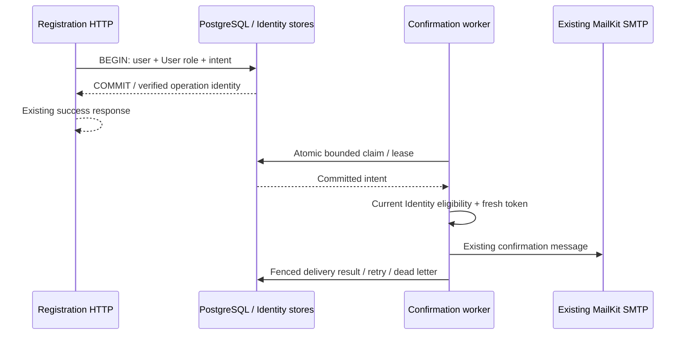

# Durable registration confirmation delivery

Implements [Issue #132](https://github.com/unrealbg/BlazorShop/issues/132), the registration/account-confirmation subset of R03/E08 in the [RC readiness audit](rc-readiness/2026-11-01/README.md). Starting master: `bd215866e0dd16a9288e12c8a05a8553cfda34ad`. **RC NO-GO and production NO-GO remain in force.** No migration against a real/staging database, release, merge or deployment is performed by this change.

## Confirmed defect and transaction decision

The former strict registration path committed an Identity user and role before synchronous SMTP. A transport exception then invoked account deletion. The original audit demonstrated an outage and an accepted-DATA/lost-ACK case, including an escaped confirmation link whose account had been deleted. The new HTTP/MailKit loopback tests reproduced HTTP 400 for both failure modes before the registration path was changed; the healthy control also demonstrated SMTP inside the HTTP request.

The selected implementation uses the existing scoped Identity EF stores and `AppDbContext` through a narrow `IRegistrationConfirmationStore` application port. `IAppUserManager`, `IAppRoleManager`, token validation, authorization and the global transaction helper are unchanged. No invasive Identity refactor or distributed transaction is required.

Strict registration executes **user creation, User-role assignment and confirmation intent insertion in one PostgreSQL transaction**. Identity's intermediate `SaveChanges` calls enlist in that same transaction. SMTP does not run in it. The port consumes storage errors inside the configured EF execution-strategy delegate, so the strategy cannot blindly replay password hashing/tracked Identity objects. It does not retry registration writes automatically.

On a missing commit acknowledgement, a fresh context checks this operation's private, immutable outbox root ID and user ID. A proven commit returns the existing success DTO/HTTP 200. A missing/unavailable proof returns HTTP 400 with an explicit uncertain-registration message; it never deletes the account. This response does **not** promise the account is absent. Retry/sign-in/confirmation can recover a committed account. Later resend generations cannot invalidate the immutable registration proof.

Real tests pause immediately before commit: neither a second connection nor the worker can see the user/intent. Enqueue, role and pre-commit faults leave neither user nor intent. Post-commit faults preserve both; verification-unavailable and concurrent resend-generation cases are tested separately.



The worker may send after the commit but before the HTTP response reaches the client. The guarantee is transactional visibility, not response-before-delivery ordering. Client disconnect/process failure after commit does not retract the account or intent. Duplicate registration does not create another account/intent or reset delivery attempts.

## Scope and public behavior

| Configuration / action | Behavior |
| --- | --- |
| `RequireConfirmedEmail=true` | Strict registration atomically creates one unconfirmed customer and one intent; sign-in remains blocked until existing Identity confirmation succeeds |
| `RequireConfirmedEmail=false` | Existing local-confirmation registration path retained, including the existing `RequireConfirmedAccount=true`/email-false combination; no outbox mail |
| Strict registration, email disabled | Success only after durable commit; account remains unconfirmed; intent stays Pending with zero attempts, never marked delivered |
| Unconfirmed sign-in | Still rejected. Existing login route is also the explicit delivery-recovery request; no new public resend endpoint |
| Recovery request | Requires the current password, an unconfirmed/unlocked account and an existing User/Admin role; serialized account-first, then intent |
| Pending matching intent | Coalesced without resetting attempts, generation or request budget |
| Delivered/dead/suppressed intent | A new generation is possible only after cooldown and within the persisted account request-window budget |
| Locked/deactivated/stamp- or email-changed account | No automatic activation/unlock. Stale work is suppressed; recovery must use current eligible Identity data |
| Active demo context | Strict durable registration/resend and dispatch are denied. Non-strict demo behavior, demo users/login and the existing isolation/lifecycle remain unchanged |

The failed-login message now truthfully describes conditional queued delivery instead of claiming a synchronous send. It is identical for eligibility, coalescing, rate limiting and storage failure, avoiding a new public password/resend-result oracle. DTO shapes, routes and successful-login/refresh behavior are unchanged. The outbox is not an authorization credential and issues no JWT, refresh token or cookie.

Only registration confirmation is moved. Bank instructions, newsletter and other email functions retain their existing delivery behavior; broader #52 work is excluded. The same MailKit `EmailService` is used through a confirmation-only keyed registration. Its transport logger is disabled for this path because an SMTP rejection can echo a secret payload; the dispatcher instead emits payload-free event/attempt warnings and persists observation fields. The normal `IEmailService` registration for other mail is unchanged. This is not a new multi-provider abstraction or template system.

## Delivery, retries and recovery

`RegistrationConfirmationDeliveries` has one unique row per user (the registration-confirmation business identity). It records an immutable root ID, current event ID/generation, recipient snapshot, SHA-256 security-stamp fingerprint, state, attempt count, lease ownership/expiry, due/attempt/delivery timestamps, request-window budget and a bounded failure code. **No password, confirmation token, link or MIME/body is stored.** Recipient addresses remain personal data within the existing database security/backup boundary. User deletion cascades its intent; no independent retention/purge job is introduced.

The worker processes a bounded batch in scopes, with fresh Identity lookup per claimed message. One PostgreSQL `UPDATE ... (SELECT ... FOR UPDATE SKIP LOCKED) RETURNING` atomically claims a row. The credential-bearing SMTP call is outside database transactions. Claim SQL is not automatically retried after an unknown outcome: no known lease means no send, and lease expiry permits recovery. Result writes require matching event ID, Processing state and lease owner, preventing late workers from overwriting a newer claim/generation.

Each claim consumes an attempt even if the process crashes before SMTP. Automatic retry has capped exponential backoff; exhausted work becomes DeadLetter. Expired final leases also reach DeadLetter without another send. Identity-ineligible or already-confirmed work becomes Suppressed. Delivered means SMTP completed and the fenced result was recorded, **not** proof that a human received/read the message.

| Failure / boundary | Confirmed handling |
| --- | --- |
| SMTP unavailable | Account/role/intent remain; bounded retries then dead letter |
| DATA accepted, ACK lost | Account remains; link follows existing Identity validity; retry can duplicate external delivery |
| Crash after claim or after SMTP before result | Lease expiry/restart recovery; attempts remain bounded; possible duplicate delivery |
| Two workers, unexpired lease | Only one dispatch owns the row |
| Lease expires while SMTP is still in flight | A second send is possible; old acknowledgement cannot overwrite new ownership |
| Already confirmed before retry | Suppress retry, no new mail or credentials |
| Storage unavailable after SMTP | Outcome may remain uncertain; lease/fenced retry recovers without deleting the account |
| Strict enqueue table missing / insertion failure | Entire uncommitted registration rolls back; safe non-success response |
| Commit completed but ACK/readback unavailable | Non-success explicitly reports uncertainty; account/intent may exist and remain recoverable |
| Duplicate registration / concurrent resend | One user/intent; one charged resend generation, no attempt-reset bypass |
| Worker/email paused | Existing intent remains pending; no claim of delivery |

There is **no exactly-once SMTP guarantee**. External delivery cannot be rolled back, cancelled retrospectively or distinguished reliably after a lost acknowledgement. Lease fences protect database state, not external SMTP effects. Eligibility is checked immediately before token generation/send, but a later concurrent account change cannot unsend an already-dispatched message. Existing Identity confirmation/sign-in checks remain authoritative.

Defaults in `RegistrationConfirmation` (no production configuration is changed):

| Option | Default | Bound / purpose |
| --- | --- | --- |
| `WorkerEnabled` | true | Pause delivery without dropping intents |
| `PollSeconds` / `BatchSize` | 5 / 10 | Validated 1–60 seconds / 1–100 claims per cycle |
| `LeaseSeconds` | 60 | Validated 30–300; existing MailKit operation has its existing 10-second cancellation budget |
| `MaxAttempts` | 5 | Validated 1–10 claims per generation |
| `InitialRetrySeconds` / `MaxRetrySeconds` | 30 / 900 | Exponential, capped; max validated at 86400 seconds |
| `ResendCooldownSeconds` | 300 | Validated 1–86400; no concurrent in-flight reset for matching work |
| `RequestWindowHours` / `MaxRequestsPerWindow` | 24 / 5 | Persisted fixed account window, not a rolling-window or global mail-volume promise |

At defaults, each accepted generation has at most five automatic claims. Registration counts as the first request in its account window. Coalescing does not charge another request or reset attempts. Explicit eligible recovery can start another bounded generation; it cannot bypass cooldown/window limits. No automatic dead-letter reset or unbounded resend loop is present. Existing HTTP rate-limit policies are retained; C03 is not addressed.

Operator recovery: inspect state, attempt/generation counts, due/lease timestamps and failure code using existing authorized database/observability access. Fix the approved transport/storage prerequisite first. Allow pending work to resume; an eligible user can request bounded recovery through the existing login route. Never mark the account confirmed, delete/recreate the user, reset Identity security stamps or expose a confirmation link as an operational workaround. No new administration UI/endpoint, production command or deployment action is added.

## Token expiry and security limits

This repository explicitly selects Identity's **`EmailTokenProvider`**, not the usual Data Protection email-confirmation provider. The pinned ASP.NET Core 10 implementation uses security-stamp/email/purpose-bound TOTP, three-minute steps and the existing ±2-step validation window. It is **not a 24-hour link**. Its short, six-digit-code properties and existing confirmation endpoint policies are unchanged and require independent release security acceptance.

The queue stores intent only. Every actual delivery attempt generates current confirmation data through the configured `UserManager`; a long-delayed intent does not reuse an already-expired stored link. A recipient opening a link later can still encounter ordinary Identity expiry and must request bounded recovery. Reissue does not itself revoke earlier unexpired codes and may produce the same code in a time step. Security-stamp/email changes are handled by existing Identity token verification; no new global token revocation policy, key provisioning or lifetime is introduced. Tests use genuine Identity verification for historical/invalidated codes, accounting for possible short-code collisions without logging them.

Dispatch does not update EmailConfirmed, roles, lockout, passwords or sessions. The recovery password check retains standard Identity behavior, including any framework password-hash upgrade. Actual confirmation alone changes the confirmation flag using the existing handler. Lock/deactivation, access-JWT lifetime, refresh rotation/replay and demo session binding remain their existing contracts.

## Additive migration and rollback

Migration: `20261101131138_AddRegistrationConfirmationOutbox` (EF Core 10). It adds only the delivery table, its indexes/check constraints and user FK. Previous migrations are not rewritten; no legacy identity/commerce rows are backfilled or modified. Demo provisioning already creates an empty temporary counterpart for every public table; confirmation data is not copied into demo workspaces, and the new services additionally reject demo work.

Real PostgreSQL 16/17 tests cover upgrade from the previous migration, existing Identity roles/password state and actual COD order/lines/inventory/idempotency/refresh data preservation. A content fingerprint is compared without logging the underlying sensitive rows. Missing-schema registration rolls back safely.

`Down` takes an exclusive table lock and **refuses any nonempty outbox**, including delivered history, so an empty check cannot race with a new committed intent. An approved schema rollback requires pausing writers/workers and preserving/archiving/removing records under an explicit retention/recovery plan; this PR does not execute that plan. Empty Down removes only the added table and preserves existing data; re-upgrade is tested.

Prefer retaining this additive table during a code rollback. Old code cannot dispatch its pending work and reintroduces the synchronous-SMTP registration defect; strict registration must not be resumed under that old behavior without an owner-approved plan. Automatic API startup migration behavior is unchanged, so any real rollout still requires explicit review/approval before starting the new binary. No real database was migrated in this work.

## Evidence matrix and review checkpoint

The repository verifier requires **33 HTTP/Identity/PostgreSQL/SMTP cases and 2 migration cases on both PostgreSQL majors**, in addition to all existing mandatory groups. CI PostgreSQL 16 includes the affected suites; full unit/integration runs retain all existing cases. No existing browser scenario, audit threshold or gate is weakened.

Local validation of the final implementation source: Release **0 warnings/errors**; complete suites on **each PostgreSQL 16 and 17: 1042 passed, 10 existing opt-in live-smoke skips**. The strict verifier confirms every mandatory new and existing group. These local results precede the documentation commit; final-head CI provenance is recorded in the PR ledger.

| Evidence | Status | Limits |
| --- | --- | --- |
| Old synchronous healthy/outage/lost-ACK behavior | FAIL reproduced before integration | New assertions intentionally failed against unchanged registration behavior; no secrets emitted |
| Atomic user/role/intent commit, enqueue/role/commit faults, lost ACK and unavailable proof | PASS locally | Real Identity/HTTP/PostgreSQL, controlled storage/transaction fault injection |
| SMTP outage, accepted DATA/lost ACK, retries, dead letter, restart, leases/concurrent workers | PASS locally | Actual loopback MailKit transport; external delivery not certified |
| Resend password/eligibility/cooldown/window/concurrency; confirmation expiry/stamp changes | PASS locally | Existing provider retained; no universal immediate code-revocation claim |
| Strict/non-strict/disabled email, admin lock/deactivate, existing Admin confirmation and demo isolation | PASS locally | Existing security suites also retained |
| SMTP payload-echo rejection | PASS locally | Confirmation transport/worker logs are checked without printing tokens or MIME |
| Additive migration, nonempty refusal, empty rollback, current-data preservation | PASS locally | Disposable PostgreSQL only; no production rehearsal |
| External SMTP authentication/TLS, deliverability/latency, sustained multi-node load and chaos | NOT TESTED | Requires an approved staging/provider scope; no external mail sent |
| Final-head CI, audits, containers/assets and browser results | Recorded in PR validation ledger | Exact SHA, original TRX/artifact/run links recorded after completion; original failures retained separately |

Local commands (disposable local-container runtime only):

```powershell
dotnet build BlazorShop.sln -c Release -warnaserror
dotnet test BlazorShop.Tests/BlazorShop.Tests.csproj -c Release --no-build --filter 'FullyQualifiedName~RegistrationConfirmationHttpTests|FullyQualifiedName~RegistrationConfirmationMigrationTests'
$env:BLAZORSHOP_TEST_POSTGRES_IMAGE = 'postgres:16.13-alpine3.23'
dotnet test BlazorShop.Tests/BlazorShop.Tests.csproj -c Release --no-build
Remove-Item Env:BLAZORSHOP_TEST_POSTGRES_IMAGE
```

Other RC findings, merchant/legal/provider gates, backup/restore and production installation checks remain open. Bank/COD/Stripe, order/inventory persistence, JWT/refresh/authorization, TLS/CORS/CSP and infrastructure are outside this change. Independent review is required before merge.

Official references: [ASP.NET Core 10 integration tests](https://learn.microsoft.com/en-us/aspnet/core/test/integration-tests?view=aspnetcore-10.0), [EF Core transactions](https://learn.microsoft.com/en-us/ef/core/saving/transactions), [EF Core connection resiliency and unknown commit outcomes](https://learn.microsoft.com/en-us/ef/core/miscellaneous/connection-resiliency), [hosted services/scopes](https://learn.microsoft.com/en-us/aspnet/core/fundamentals/host/hosted-services?view=aspnetcore-10.0), [Identity EmailTokenProvider](https://github.com/dotnet/aspnetcore/blob/v10.0.5/src/Identity/Extensions.Core/src/EmailTokenProvider.cs), [Identity TOTP validation](https://github.com/dotnet/aspnetcore/blob/v10.0.5/src/Identity/Extensions.Core/src/Rfc6238AuthenticationService.cs), [PostgreSQL row locks](https://www.postgresql.org/docs/17/explicit-locking.html).
