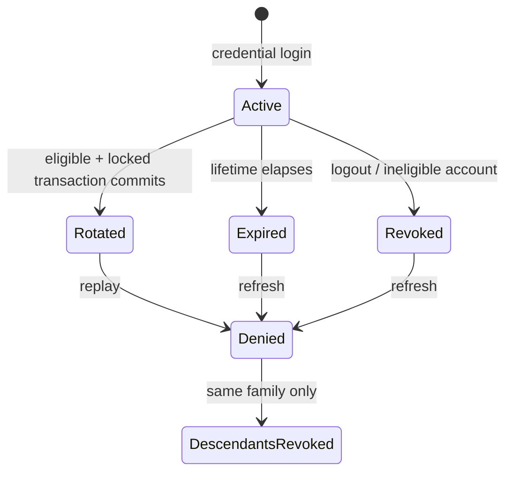

# Atomic refresh rotation and browser coordination

## Problem and baseline proof

At baseline `85c6afa009fe6bd2ea88eef708a9b29f74a79851`, refresh read an active credential, inserted its successor, and revoked/linked the predecessor in separate operations. The account lock protected insertion against administrative lockout, but did not serialize the whole rotation. Two requests could both read the same active credential and both report success.

Test-only commit `101ed59a53b12221d1ea540290004d215ff65080` reproduces this through the real authentication controller, ASP.NET Identity and disposable PostgreSQL. A command interceptor releases both initial reads together. No timing sleep is used. `ConcurrentSameCredential_ExactlyOneSuccessAndNoFork` expected one successful HTTP response and observed two. See the [original failing CI run](https://github.com/unrealbg/BlazorShop/actions/runs/41236276629) and its PostgreSQL 17 build/test job and PostgreSQL 16 regression job. No credentials are included in assertion diagnostics.

## Server state machine



`IAppTokenManager.RotateRefreshTokenAsync` is an internal transaction contract. It returns an ephemeral replacement credential and claims only after confirmed commit. `AuthenticationService` generates the access JWT afterwards. Neither a failed transaction nor an uncertain commit returns credentials. The HTTP endpoint and JSON/cookie contracts are unchanged.

The PostgreSQL operation is:

1. Read only the owner ID by credential hash, without tracking. This preliminary lookup makes no authorization decision.
2. Begin a READ COMMITTED transaction on the request's existing `AppDbContext` connection.
3. Lock the account row (`FOR UPDATE`), then the presented token row (`FOR UPDATE`), and read fresh values.
4. Check token activity and current Identity confirmation/lockout eligibility under the account lock.
5. For an eligible active token, insert one cryptographically random, hashed replacement and revoke/link its predecessor within the same transaction.
6. Commit, check request cancellation, then permit JWT generation and the HTTP response.

Rotation and logout acquire the same account-first lock. Administrative session revocation also takes the account lock before updating tokens. Identity's account UPDATE serializes against this lock: refresh that wins the lock may finish before the administrator revokes its replacement; refresh after a committed lock/deactivation cannot issue a replacement. No token-first/account-second writer is introduced. Independent families are serialized briefly for the same account, but are not revoked together except by the existing administrative policy.

The existing configured EF execution strategy hosts the explicit transaction. An invocation guard prevents its delegate from performing any second database attempt. Storage errors, cancellation and uncertain commit acknowledgements fail closed. A transaction is never blindly re-executed with an already-consumed credential. Administrative bulk revocation remains idempotent and can use its existing execution strategy safely.

No schema, uniqueness constraint, token lifetime, JWT issuer/audience, authentication policy or global role/password revocation policy changes. The demo request continues to use its leased isolated PostgreSQL connection; rotation does not create another context or rebind to the normal store.

## Strict replay, logout and lost responses

There is no replay grace period and no recovery of the replacement secret. A second use of a rotated token denies issuance and revokes its descendants. Two truly concurrent same-cookie HTTP refresh requests therefore produce exactly one success, but the losing request can revoke the winner's successor. This is intentional strict replay protection. Cooperating browser tabs avoid that duplicate request through the coordinator.

Logout revokes the presented token and its descendants under the same lock. This closes the case where an old-cookie logout overlaps a successful rotation. Repeated logout remains idempotent, and an independently established browser family remains valid.

If commit succeeded but its acknowledgement or HTTP response was lost, the database can contain a correctly linked successor whose secret was not delivered. It is not an unlinked/orphaned token. The server does not return or recover that secret. The client clears authentication state, publishes a signed-out intent and requires explicit sign-in instead of retrying the uncertain refresh. Explicit malicious reuse of the predecessor still revokes its descendant. Abandoned linked tokens expire or are removed by existing account/session revocation; no new global revocation policy is introduced.

## Browser flow

Actual refresh entry points are initial bootstrap, private-client HTTP 401 handling, cross-tab authentication notifications, and profile refresh. They all use `AuthenticationSessionRefresher`.

```mermaid
sequenceDiagram
    participant A as Tab A
    participant L as Origin Web Lock
    participant API
    participant B as Tab B
    A->>L: request exclusive authentication lock
    B->>L: queue refresh/login/logout
    L-->>A: lock acquired
    A->>A: recheck tab JWT and shared intent epoch
    A->>API: one refresh POST, credentials included
    API->>API: account lock, token lock, rotate, COMMIT
    API-->>A: JWT + HttpOnly replacement cookie
    A->>A: discard result if a newer logout/login intent exists
    A-->>L: release after HTTP and state processing
    L-->>B: acquire; re-evaluate current state/cookie
```

A non-secret `pending` marker is written under the lock immediately before sending a refresh POST and removed only when its successful response can be accepted. If a document disappears while the outcome is unresolved, the next lock owner detects that marker and requires sign-in without submitting the old cookie. Login/logout intents supersede the marker using a new epoch. Token storage and epoch validation occur in the same JavaScript turn to avoid same-document async gaps. Cross-tab intent delivery is asynchronous; the Web Lock provides the ordering guarantee for completed credential operations, and newer intent notifications clear the affected tab state. No pre-existing refresh callback can outlive a completed coordinated server logout. Metadata itself is not a cross-tab mutex or server authorization.

Within a tab, concurrent callers share one in-flight task. The coordinator and refresher have WebAssembly-host singleton lifetimes so that HttpClientFactory handler scopes share the same instance as bootstrap/profile/UI callers. This registration is client-only and must not be used for shared server-side authentication state. Queued 401 responses reuse a newer JWT where possible; identical JWT serialization within the same issuance second also does not cause a second rotation for the same rejected JWT. Each tab retains its own JWT in sessionStorage. Two tabs that both need JWTs can rotate sequentially with the browser's latest HttpOnly cookie; JWTs are not copied between tabs. Refresh notifies the authentication cascade when identity/role claims change or a previously invalid/missing JWT becomes valid; renewal of token timing metadata alone does not recreate the current page or duplicate its business GETs.

Login, demo provisioning plus login, and logout use the same origin-scoped Web Lock as refresh. Login/logout announce a new non-secret intent epoch before waiting. The refresh response may update client state only while its epoch is current. Logout clears local state immediately and then, under the lock, revokes/deletes the latest browser cookie. Bootstrap always consults the coordinator, including when sessionStorage still contains a JWT from before a missed logout notification.

localStorage contains only intent metadata (`epoch`, `status`) and notifications (`type`, `epoch`, `nonce`). These are untrusted UI coordination hints, never business authorization. Neither JWTs, refresh credentials, cookie values nor service credentials enter localStorage, BroadcastChannel or URLs. If a credential login supersedes an already running flight, its notification re-evaluates the new session after the old flight completes, only while that announced epoch remains signed in. A failed/uncertain refresh instead changes the epoch to signed out and cannot take this path. Stale notifications are ignored against the current stored event and epoch; duplicate notification nonces are ignored. Signed-in notifications with a current tab JWT do not rotate; a distinct profile-change notification explicitly refreshes claims, preserving profile synchronization even while the old JWT remains valid.

Web Locks are required for credential-changing browser operations. There is deliberately no localStorage spin-lock fallback. A missing/rejected API or a queued acquisition timeout sends no credential POST and clears local authentication state. The sign-in UI reports coordination unavailability; the user must restore Web Locks availability/use a supported secure browser before explicit sign-in. A timeout only cancels lock acquisition. It never releases an acquired lock while its HTTP request remains in flight. Closing/navigating away from the owning document releases its Web Lock; an interrupted refresh may require fresh sign-in.

The public WebAssembly HttpClient has only the existing credentials handler, with no resilience/retry handler. Refresh never uses the private 401 handler recursively. Its browser Fetch redirect mode is explicitly `error`, preventing implicit 307/308 reposting. Private GET retry after a successful refresh remains limited to the existing policy; the refresh POST itself is never automatically retried.

## Failure matrix

| Event | Database / HTTP outcome | Browser outcome |
| --- | --- | --- |
| Concurrent same-cookie refresh | One committed successor; one success; loser denies and revokes descendants | Cooperating tabs serialize; direct duplicates retain strict replay semantics |
| Failure before commit | Entire rotation rolls back, no successor | Signed out; no automatic retry |
| Unknown commit acknowledgement | No credentials returned; either rollback or a linked committed successor | Explicit sign-in required |
| HTTP response lost / network timeout after commit | Committed linked successor may remain undelivered | Signed-out intent prevents reload retry |
| Cancellation before commit | Rollback; no successful response | No credentials restored |
| Cancellation after commit | No successful credential delivery; committed lineage remains intact | Explicit sign-in required |
| Account lock/deactivate before refresh | Denial; presented family revoked; admin policy revokes all account sessions | Signed out |
| Account lock after refresh linearizes | Committed replacement subsequently revoked | Existing access JWT lifetime remains unchanged |
| Logout overlaps rotation | Account lock serializes revocation of current descendant | Late response cannot restore local authentication |
| Lock acquisition unavailable / cancelled / timed out | No credential POST | No simulated cross-tab mutex; sign-in requires supported Web Locks |
| Observation request | No rotation, issuance, family revocation or demo TTL extension | Existing SSR read-only behavior preserved |

## Validation and review evidence

The HTTP/PostgreSQL suite covers exactly-one rotation/no fork, rollback, ambiguous commit acknowledgement, real request cancellation before/after commit, lost delivery and attempted replay, invalid/expired/revoked/missing credentials, logout concurrency and independent families, plus normal/demo context separation. Existing C01 ordering, confirmation, authorization and C02 observation tests remain in the full gate and PostgreSQL 16 regression filter.

Eleven mandatory Playwright scenarios cover concurrent bootstraps, two-tab 401s, one-tab 401 bursts and duplicate/stale events, logout during a committed delayed response, login during refresh, lost HTTP response/reload, missing/rejected Web Locks, acquisition timeout/tab interruption, a tab closing with an unresolved committed refresh, rejecting a 307 without reposting the cookie, and profile claim synchronization with nonce deduplication. Chromium executes these alongside all original 27 scenarios twice. Firefox and WebKit run the targeted coordination suite. Strict TRX verification requires every expected scenario to pass.

CI publishes security TRX results for PostgreSQL 16 and 17, full/runtime npm and transitive NuGet audit JSON, container/published-asset checks, and browser results/screenshots. The final PR validation summary identifies the exact tested head SHA and corresponding CI and Code Analysis runs. A green run on an earlier implementation commit is not final-head evidence.

## Remaining limits and release prerequisites

- This PR is not deployment approval. C03 proxy attribution and unified routing remain separate work.
- Origin Web Locks coordinate tabs of this WebAssembly origin. They do not coordinate distinct public origins, browser profiles or non-cooperating HTTP clients; server atomicity/replay protection remains authoritative.
- Production observation remains disabled until separately approved server-only credential provisioning and HTTPS transport.
- Already issued access JWTs remain valid for up to two hours. Immediate revocation requires a separate owner decision.
- Strict replay and uncertain delivery favor security over silent session recovery. Fresh sign-in can be necessary after interrupted requests.
- Existing payment, inventory, checkout, order, SSR/SEO and public URL contracts remain outside this change.

## References

Design follows [EF Core transactions](https://learn.microsoft.com/en-us/ef/core/saving/transactions), [EF execution strategies and commit failures](https://learn.microsoft.com/en-us/ef/core/miscellaneous/connection-resiliency), [Npgsql transactions](https://www.npgsql.org/doc/basic-usage.html#transactions), [Web Locks request semantics](https://developer.mozilla.org/en-US/docs/Web/API/LockManager/request), [storage event delivery](https://developer.mozilla.org/en-US/docs/Web/API/Window/storage_event), [Blazor WebAssembly security](https://learn.microsoft.com/en-us/aspnet/core/blazor/security/webassembly/?view=aspnetcore-10.0) and [Playwright browser runner configuration](https://playwright.dev/dotnet/docs/test-runners).
